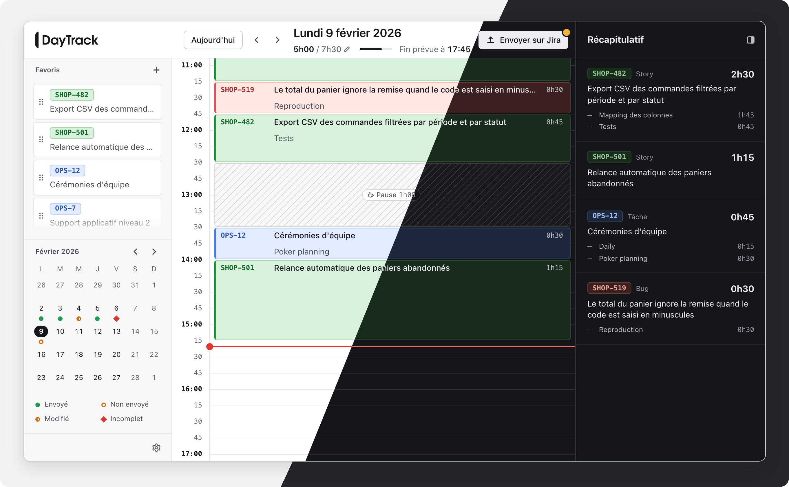

<p align="center">
  
  
</p>

<p align="center"><strong>Notez votre journée au quart d'heure, puis envoyez-la sur Jira.</strong></p>

<p align="center">
  <a href="https://github.com/valentinlegal/daytrack/releases/latest"></a>
  <a href="LICENSE"></a>
</p>

<p align="center">
  <a href="#installer">Installer</a> ·
  <a href="#mettre-à-jour">Mettre à jour</a> ·
  <a href="#aller-plus-loin">Aller plus loin</a> ·
  <a href="#signaler-un-bug-proposer-une-idée">Signaler un bug</a>
</p>

<p align="center">
  
  
</p>

DayTrack est un logiciel de suivi du temps : vous remplissez une grille, ticket par ticket, puis vous envoyez la journée sur Jira. Il s'installe sur votre poste, sans compte, et vos données restent chez vous.

## Ce qu'il fait

<table>
<tbody>
<tr>
<td width="50%" valign="top">


**Une grille comme un tableur**

Sélection à la souris ou au clavier, copier, couper, coller, remplacer ou modifier une partie d'un bloc. Annuler et rétablir couvrent jusqu'à 50 gestes par journée.

</td>
<td width="50%" valign="top">


**Un envoi sur Jira qui se vérifie**

Il remplace vos heures du jour, et seulement les vôtres. Un échec se dit ticket par ticket, et la journée n'est marquée envoyée que si Jira a bien tout reçu.

</td>
</tr>
</tbody>
<tbody>
<tr>
<td width="50%" valign="top">


**Vos tickets sous la main**

Des favoris à poser sur la grille d'un geste, et le titre de chaque ticket lu dans Jira.

</td>
<td width="50%" valign="top">


**Le mois d'un coup d'œil**

Le calendrier marque les jours envoyés, ceux modifiés depuis l'envoi et ceux restés incomplets, un jour oublié compris. Un jour de congé se déclare par un objectif à 0h00.

</td>
</tr>
</tbody>
</table>

<p align="center">
  
</p>

**Vos chiffres du jour, de jour comme de nuit.** Le temps travaillé, le reste, le solde et l'heure de fin prévue, pauses déduites. En clair ou en sombre, avec vos jours travaillés, votre objectif habituel et vos couleurs par type de ticket.

## Installer

Avec Docker :

```bash
curl -O https://raw.githubusercontent.com/valentinlegal/daytrack/main/docker-compose.yml
docker compose up -d
```

DayTrack répond sur <https://localhost>, à votre machine seulement, et vous propose de relier Jira. Votre jeton reste chez vous, chiffré, et ne part que vers Jira.

Le certificat est fabriqué sur votre machine : le navigateur vous avertit tant que vous ne l'avez pas approuvé.

<details>
<summary>Approuver le certificat</summary>

```bash
docker compose cp daytrack:/data/caddy/pki/authorities/local/root.crt daytrack.crt
```

Puis, selon votre système :

```bash
# macOS
sudo security add-trusted-cert -d -r trustRoot -k /Library/Keychains/System.keychain daytrack.crt

# Linux (Debian, Ubuntu)
sudo cp daytrack.crt /usr/local/share/ca-certificates/daytrack.crt && sudo update-ca-certificates

# Windows, dans un terminal administrateur
certutil -addstore -f ROOT daytrack.crt
```

</details>

## Mettre à jour

DayTrack vous prévient quand une nouvelle version existe.

```bash
docker compose pull
docker compose up -d
```

<details>
<summary>Vous venez de DayTrack 1</summary>

Les mêmes commandes suffisent. Au premier démarrage, DayTrack 2 reprend vos journées, vos saisies, vos pauses, vos favoris et votre configuration Jira. Votre ancienne base n'est jamais modifiée. Ce qui n'a pas pu être repris est listé à l'écran.

Ce que DayTrack 2 change :

- L'écran est entièrement refait, autour d'une grille qu'on manipule à la souris et au clavier.
- Tout se règle dans l'application, Jira compris. Une fois la reprise faite, l'ancien `docker-compose.yml` ne sert plus.
- DayTrack ne répond plus qu'à votre machine. Un bandeau vous donne les commandes pour remplacer votre ancien fichier, qui écoute encore tout le réseau. Si DayTrack est derrière votre proxy, il vous dit plutôt quelles lignes y changer.

Pour revenir en arrière, reprenez l'image `ghcr.io/valentinlegal/daytrack:1.1.0`. Vous retrouverez la v1 telle que vous l'aviez laissée, sans ce que vous avez saisi depuis.

</details>

## Aller plus loin

<details>
<summary><strong>Sauvegarder et restaurer</strong></summary>

Vos données vivent dans deux volumes Docker : la base, et la clé qui chiffre votre jeton Jira. Ces commandes gardent les deux dans un fichier, en arrêtant DayTrack quelques secondes.

```bash
docker compose stop
docker compose run --rm -T --no-deps --entrypoint tar daytrack czf - -C / app/db data > daytrack-$(date +%F).tar.gz
docker compose start
```

**Gardez ce fichier à l'abri** : il contient votre jeton Jira et de quoi le lire.

Pour restaurer, dans le dossier de votre `docker-compose.yml`, en remplaçant la date :

```bash
docker compose down
docker compose run --rm -T --no-deps --entrypoint sh daytrack -c 'rm -rf /app/db/* /data/* && tar xzf - -C /' < daytrack-AAAA-MM-JJ.tar.gz
docker compose up -d
```

Cette restauration remplace tout ce que contient DayTrack par ce que contient le fichier.

</details>

<details>
<summary><strong>Derrière votre propre proxy</strong></summary>

Par défaut, DayTrack ne répond qu'à votre machine, et c'est voulu.

> **Le risque.** DayTrack n'a pas de compte : quiconque atteint son adresse agit en votre nom, jusque dans Jira. L'ouvrir à un réseau est votre choix : protégez cette adresse vous-même, et servez-la en HTTPS.

Votre proxy s'occupe alors du HTTPS, et DayTrack lui répond en HTTP. Dans `docker-compose.yml` :

```yaml
    ports:
      - "127.0.0.1:8080:80" # Le port que joint votre proxy
    environment:
      SERVER_NAME: ":80"
      TRUSTED_PROXIES: "private_ranges" # L'adresse de votre proxy, si vous la connaissez
```

Votre proxy doit transmettre l'adresse d'origine (`X-Forwarded-Proto`, `X-Forwarded-Host`).

</details>

<details>
<summary><strong>Modifier DayTrack</strong></summary>

Vous pouvez adapter DayTrack à vos besoins.

```bash
git clone https://github.com/valentinlegal/daytrack.git
cd daytrack
bin/setup
```

La version de développement répond sur <https://localhost:8443>, pour tourner à côté de votre installation, et un Jira simulé sur <https://localhost:8444/_simulation> : rien ne part vers un vrai Jira. Pour le relier, indiquez l'adresse `https://jira`, le compte `dev@daytrack.test` et le jeton `jeton-de-developpement`.

Relancez `bin/setup` après chaque `git pull`.

**Les tests et les vérifications**

```bash
docker compose exec app php bin/phpunit                  # tests du serveur
docker compose run --rm node npm test                    # tests du navigateur
docker compose --profile tests run --rm playwright npx playwright test --update-snapshots  # parcours dans Chromium
docker compose exec app vendor/bin/phpstan analyse       # analyse statique
docker compose exec app vendor/bin/php-cs-fixer fix      # style PHP
docker compose run --rm node npm run lint                # types et style du navigateur
```

Les captures se créent au premier passage, avec `--update-snapshots`. Elles ne se comparent que sur l'architecture de leurs références, celle d'un Mac Apple, nommée dans `tests/e2e/references-arch` : ailleurs, elles se prennent pour être regardées, dans `test-results/`. Pour les comparer sur une autre machine, écrivez son architecture dans ce fichier (`x64` pour un PC), puis reprenez-les.

</details>

## Signaler un bug, proposer une idée

DayTrack est un projet personnel, développé selon mes besoins et mon temps. Je lis tout, mais je ne promets ni réponse ni délai.

- **Un bug** : [ouvrez un ticket](https://github.com/valentinlegal/daytrack/issues/new/choose).
- **Une idée, ou une modification faite dans votre fork** : [proposez-la dans les Discussions](https://github.com/valentinlegal/daytrack/discussions/categories/propositions). Le code ne se contribue pas directement : si une proposition me plaît, je m'en inspire de mon côté.
- **Une faille de sécurité** : [signalez-la en privé](https://github.com/valentinlegal/daytrack/security/advisories/new).

## Licence

[MIT avec la Commons Clause](LICENSE) : vous pouvez installer DayTrack, vous en servir au travail, le modifier et partager vos modifications gratuitement, en conservant le copyright et cette licence. Vous ne pouvez pas le vendre, ni vendre un service dont la valeur vient essentiellement de lui, hébergement et support compris.

© 2026 Valentin Le Gal
